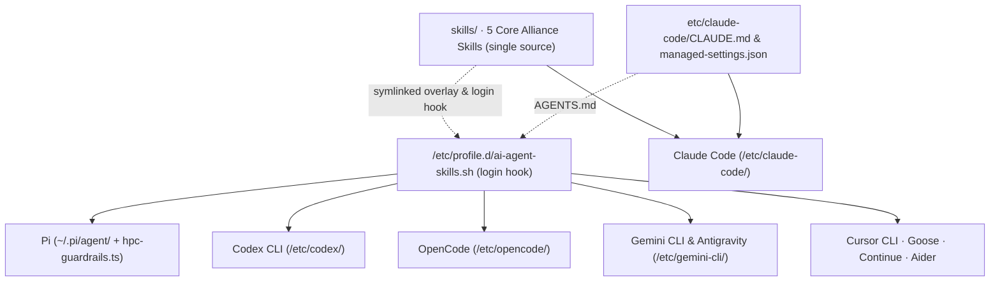

# Alliance Cluster Skills & Guardrails

[](./LICENSE)
[](./skills/)
[](./community-skills/)
[](#-login-node-guardrails)

> **Skills, open guardrails, and backend configs for operating AI coding agents on shared HPC clusters.**
>
> *One central skill tree. Usability-first login-node policies across every harness.*

*Developed in the [University of Alberta](https://www.ualberta.ca/en/information-services-and-technology/research-computing/index.html) / [AMII](https://www.amii.ca/) Vulcan environment for Digital Research Alliance of Canada HPC and cloud clusters, and adaptable to any Slurm/CVMFS site.*

**Maintained by:** Rahim Khoja ([khoja1@ualberta.ca](mailto:khoja1@ualberta.ca)) and Karim Ali ([kali2@ualberta.ca](mailto:kali2@ualberta.ca))

[Overview](#-overview) · [Quick Install](#-quick-install) · [Alliance Skills](#-core-alliance-skills) · [Community Skills](#-community-research-skills) · [Guardrails](#-login-node-guardrails) · [Backend Templates](#-agent-backend-templates) · [Deploy](#-deploying-on-a-login-node) · [Changelog](./CHANGELOG.md) · [Support](#-support)

---

## 📖 Overview

On a shared HPC login node, researchers use many different AI coding harnesses — **Claude Code, Pi, OpenAI Codex CLI, OpenCode, Google Gemini CLI, Google Antigravity (`agy`), Cursor CLI, Aider, Goose, and Continue** — and every command an agent runs executes under the researcher's UID on shared infrastructure.

This repository centralizes everything needed to run those agents well on an HPC cluster:
- **Core Alliance cluster skills (`skills/`)** teaching agents how to discover CVMFS/Lmod modules, submit Lua auto-routed Slurm jobs, query live Alliance documentation, provision Arbutus OpenStack resources, and authenticate with `git.computecanada.ca` — stored **once** and symlinked across every harness.
- **Curated scientific & HPC community skills (`community-skills/`)** covering Globus Compute remote job execution, PyTorch Lightning DDP/FSDP, NVIDIA GPU/RAPIDS optimization, Dask, Polars, Biopython, Scanpy, RDKit, Pymatgen, and publication figures.
- **Open, usability-first login-node guardrails (`etc/` & `cursor/`)** mirroring Vulcan's live Warewulf baseline so normal SSH, SCP, `sudo`, and research workflows stay friction-free while destructive commands and credential harvesting are blocked.
- **Ready-to-copy backend templates (`claude/`, `pi/`, `opencode/`, `aider/`)** pre-configured for hosted Vulcan Aleph inference as well as Z.AI, DeepSeek, and Kimi.



---

## ⚡ Quick Install

On clusters where `etc/` is deployed (such as Vulcan), the 5 core Alliance skills and cluster instructions are linked into your home directory automatically at login.

On any workstation, laptop, or other cluster, install skills directly with GitHub CLI's **[`gh skill install`](https://cli.github.com/manual/gh_skill_install)** (`gh` v2.90+):

```bash
# Interactive picker — choose from all 5 Alliance skills + 10 community research skills
gh skill install ualberta-rcg/drac-agent-skills

# Install for a specific harness at user scope (available in every directory)
gh skill install ualberta-rcg/drac-agent-skills --all --agent claude-code --scope user
gh skill install ualberta-rcg/drac-agent-skills --all --agent pi --scope user
gh skill install ualberta-rcg/drac-agent-skills --all --agent opencode --scope user
gh skill install ualberta-rcg/drac-agent-skills --all --agent codex --scope user
gh skill install ualberta-rcg/drac-agent-skills --all --agent cursor --scope user
gh skill install ualberta-rcg/drac-agent-skills --all --agent gemini-cli --scope user
gh skill install ualberta-rcg/drac-agent-skills --all --agent antigravity-cli --scope user

# Install a single skill (core Alliance or community research)
gh skill install ualberta-rcg/drac-agent-skills alliance-slurm --agent pi --scope user
gh skill install ualberta-rcg/drac-agent-skills globus-compute --agent claude-code --scope user
```

**Alternative installers** (when `gh` v2.90+ is not installed):

```bash
# Universal Node CLI (79+ agents)
npx skills add ualberta-rcg/drac-agent-skills -g

# Claude Code in-session plugin marketplace
# /plugin marketplace add ualberta-rcg/drac-agent-skills

# Plain Git clone (zero dependencies — works for ~/.claude/skills, ~/.pi/agent/skills, ~/.agents/skills, ~/.cursor/skills)
git clone https://github.com/ualberta-rcg/drac-agent-skills.git
mkdir -p ~/.claude/skills ~/.pi/agent/skills ~/.agents/skills
cp -r drac-agent-skills/skills/* ~/.claude/skills/
cp -r drac-agent-skills/skills/* ~/.pi/agent/skills/
```

---

## 📦 Core Alliance Skills

Stored once in [`skills/`](./skills/) and deployed system-wide on login nodes via `/etc/claude-code/.claude/skills` (with relative symlinks at `/etc/agents/skills` and `/etc/codex/skills`):

| Skill | What it teaches the agent |
|---|---|
| `alliance-cvmfs` | Software discovery and loading via CVMFS/Lmod (`module spider`, tier hierarchy, `$SCRATCH` Python venvs, Alliance wheelhouse `--no-index`, Apptainer). |
| `alliance-slurm` | Job submission and monitoring (GPU/GRES discovery, MIG and soft-MIG shards, Lua auto-routing without `--partition`, prolog caches/proxies, job templates). |
| `alliance-docs` | Semantic lookup against the live Alliance documentation RAG API (`docs-api.vulcan.alliancecan.ca`) for current quotas, policies, storage, and site guides. |
| `alliance-arbutus` | Arbutus OpenStack cloud (`*.arbutus.alliancecan.ca`) and Terraform (`v3websso` SSO, application credentials, `p`/`cm`/`cb` flavors, `rbd1` volumes, router limits). |
| `alliance-gitlab` | Compute Canada GitLab (`git.computecanada.ca`) — configures the required `gitlab@` SSH user instead of `git@`. |

---

## 🔬 Community Research Skills

Bundled in [`community-skills/skills/`](./community-skills/) (kept separate from `etc/` so login nodes stay lightweight by default, while discoverable immediately via `gh skill install ualberta-rcg/drac-agent-skills <skill>`):

| Skill | Domain | Summary |
|---|---|---|
| `globus-compute` | Remote Slurm Execution | Globus OAuth, Jinja2 template-capable Slurm endpoints (Alliance & NERSC), and remote Python execution via `globus-compute-sdk` (`gc_auth.py`, `gc_run.py`). |
| `pytorch-lightning` | Multi-GPU Deep Learning | `LightningModule`, `LightningDataModule`, Slurm multi-GPU/multi-node `Trainer` (`DDP`, `FSDP`, `DeepSpeed`), mixed precision, and `TorchMetrics` sync. |
| `optimize-for-gpu` | CUDA & RAPIDS | Evidence-driven NVIDIA GPU acceleration across CuPy, cuDF, cuML, cuGraph, cuVS, cuCIM, KvikIO, Numba-CUDA, and Warp with CUDA-event benchmarking. |
| `dask` | Parallel & Out-of-Core | Larger-than-RAM DataFrames, chunked Zarr/HDF5 Arrays, Bags, Futures, and `$SLURM_TMPDIR`-backed local/distributed clusters. |
| `polars` | Columnar DataFrames | Multi-threaded LazyFrame query optimization, streaming Parquet pipelines, Arrow zero-copy, and scientific null/`NaN`/join validation. |
| `biopython` | Bioinformatics | Streaming `SeqIO` (`FASTA`/`FASTQ`/`GenBank`), `PairwiseAligner`, NCBI Entrez, local BLAST+ XML parsing, `Bio.PDB`/`MMCIFParser`, and `Bio.Phylo`. |
| `scanpy` | Single-Cell RNA-seq | `AnnData` workflows preserving `layers["counts"]` vs `.raw`, QC, HVGs, PCA/UMAP, `igraph` Leiden clustering, batch integration, and pseudobulk DE prep. |
| `rdkit` | Cheminformatics | SMILES/SDF sanitization, descriptors (`MW`, `LogP`, `TPSA`, `QED`), `rdFingerprintGenerator` Morgan/ECFP fingerprints, SMARTS search, and ETKDGv3 3D conformers. |
| `pymatgen` | Materials Science | Periodic `Structure` & `Molecule` validation, CIF/POSCAR/VASP I/O, tolerance-swept symmetry, phase diagrams, and bounded Materials Project queries. |
| `scientific-visualization` | Publication Figures | Colorblind-safe (Okabe–Ito) multi-panel Matplotlib/Seaborn/Plotly figures, honest baselines & uncertainty encodings, Type 42 font embedding, and journal checks. |

### External Skill Repositories for Researchers

Install specialized skills directly from these upstream catalogs with `gh skill install`:

| Repository | Focus | Example Command |
|---|---|---|
| **[AI-ModCon/genesis-skills](https://github.com/AI-ModCon/genesis-skills)** | U.S. DOE / AmSC HPC skills (`globus-compute`, `amsc-data-movement-api`, `slurm`, `pbs`, `lm-eval-harness-skills`, `literature-search`) | `gh skill install AI-ModCon/genesis-skills amsc-data-movement-api --agent claude-code --scope user` |
| **[globus/ai-hub](https://github.com/globus/ai-hub)** | Official Globus team `globus-developer` skill (`globus-sdk`, `@globus/sdk`, Auth/`data_access` scopes, Transfer, Flows, Compute, Timers) | `gh skill install globus/ai-hub globus-developer --agent claude-code --scope user` |
| **[K-Dense-AI/claude-scientific-skills](https://github.com/K-Dense-AI/claude-scientific-skills)** | 170+ MIT scientific skills (`esm`, `diffdock`, `astropy`, `sympy`, `nextflow`, `zarr-python`, `molecular-dynamics`, `scientific-writing`, `latex-posters`) | `gh skill install K-Dense-AI/claude-scientific-skills scientific-writing --agent pi --scope user` |
| **[anthropics/life-sciences](https://github.com/anthropics/life-sciences)** | Anthropic's Claude for Life Sciences (`binder-gauntlet`, `clinical-trial-protocol-skill`, `clinical-trial-forecast`, `scientific-problem-selection`) | `/plugin marketplace add anthropics/life-sciences` |
| **[anthropics/skills](https://github.com/anthropics/skills)** | Official Anthropic document & developer skills (`pdf`, `docx`, `xlsx`, `pptx`, `mcp-builder`, `skill-creator`) | `gh skill install anthropics/skills pdf --agent claude-code --scope user` |
| **[github/awesome-copilot](https://github.com/github/awesome-copilot)** | GitHub's curated coding, Git, CI/CD, and engineering workflow skills | `gh skill install github/awesome-copilot --agent claude-code --scope user` |

---

## 🛡️ Login-Node Guardrails

The `etc/` and `cursor/` configs mirror Vulcan's deployed, usability-first Claude Code baseline across every major harness:

- **Hard-blocked (`deny` / `forbidden`)**:
  - Privilege/auth edits & destructive disk tools: `su`, `passwd`, `visudo`, `vipw`, `dd`, `mkfs`, `fdisk`, `shred`, `chmod 777`, `chmod -R 777`, `crontab -r`
  - Raw sockets & terminal broadcasts: `nc`, `ncat`, `socat`, `telnet`, `wall`, `write`
  - Slurm/node admin mutations: `scontrol show partition` (Lua auto-routes; use `sinfo`), `scontrol reboot`, `scontrol update Node/Partition`, `sacctmgr add/modify/remove/create/delete`, `shutdown`, `reboot`, `init 0`
  - Credential & protected file reads: `/etc/shadow`, `/etc/gshadow`, `/etc/sudoers*`, `/etc/sssd/**`, `/root/**`, `/var/spool/cron/**`, `/var/log/**`, `~/.ssh/**`, `~/.gnupg/**`, `~/.kube/**`, `~/.docker/config.json`, `~/.git-credentials`, `~/.netrc`, `**/credentials.json`, `**/.credentials.json`, `**/.env`, `**/.env.*`, `~/.codex/auth.json`
- **Prompts for confirmation (`ask` / `prompt` / `ask_user`)**:
  - `scancel`, `pkill`, `killall`, `chown`, `chmod`, `crontab`, `ldapsearch`, `getent passwd`
- **Kept open for researchers & admins**:
  - Normal `ssh`, `scp`, `rsync`, `git`, `sudo`, and workspace operations run without prompt fatigue.

| Harness | Policy & Wiring Files | Notes |
|---|---|---|
| **Claude Code** | [`etc/claude-code/managed-settings.json`](./etc/claude-code/managed-settings.json), [`CLAUDE.md`](./etc/claude-code/CLAUDE.md), [`update-motd.sh`](./etc/claude-code/update-motd.sh), [`etc/cron.d/claude-motd`](./etc/cron.d/claude-motd) | Disables `--dangerously-skip-permissions`, disables non-essential telemetry, cleans transcripts after 14 days, and rotates a 5-min cluster reminder + sci-fi quote in `companyAnnouncements`. |
| **Pi (`pi-coding-agent`)** | [`etc/pi/extensions/hpc-guardrails.ts`](./etc/pi/extensions/hpc-guardrails.ts), [`etc/profile.d/ai-agent-skills.sh`](./etc/profile.d/ai-agent-skills.sh) | Subscribes to `pi.on("tool_call")` to enforce the exact `deny` / `ask` / `read` baseline; linked automatically into `~/.pi/agent/{skills,AGENTS.md,extensions}` at login. |
| **OpenAI Codex CLI** | [`etc/codex/config.toml`](./etc/codex/config.toml), [`etc/codex/requirements.toml`](./etc/codex/requirements.toml) | Locks `allowed_sandbox_modes = ["read-only", "workspace-write"]`, `allowed_approval_policies = ["untrusted", "on-request"]`, and `[rules] prefix_rules`. |
| **OpenCode** | [`etc/opencode/opencode.json`](./etc/opencode/opencode.json) | Disables `autoupdate`, injects `/etc/agents/AGENTS.md`, and enforces `permission.bash` & `permission.read` (evaluated last-match-wins; never append a trailing `"*": "allow"`). |
| **Gemini CLI & Antigravity (`agy`)** | [`etc/gemini-cli/settings.json`](./etc/gemini-cli/settings.json), [`hpc-guardrails.toml`](./etc/gemini-cli/policies/hpc-guardrails.toml), [`admin_settings.json.example`](./etc/antigravity/admin_settings.json.example) | Disables telemetry and auto-updates; enforces admin-tier (`800`–`900`) `run_shell_command` and `read_file` rules; links skills and `AGENTS.md` into `~/.gemini/`. |
| **Cursor CLI / Remote-SSH** | [`cursor/cli-config.json`](./cursor/cli-config.json), [`etc/profile.d/ai-agent-skills.sh`](./etc/profile.d/ai-agent-skills.sh) | Links central skills into `~/.cursor/skills/` at login and maps the cluster `deny` baseline to Cursor's `Shell(...)` / `Read(...)` schema. |
| **Aider · Goose · Continue** | [`aider/aider.conf.yml`](./aider/aider.conf.yml), `~/.agents/skills/` | Goose, Continue, Cline, Roo, and Windsurf pick up `~/.agents/skills/` automatically; `aider.conf.yml` loads `/etc/agents/AGENTS.md` and disables analytics. |
| **Warewulf Agent Installer** | [`etc/ansible/playbooks/93-ai-agents.yaml`](./etc/ansible/playbooks/93-ai-agents.yaml) | Boot-time playbook installing Claude Code (signed apt repo), Codex CLI, OpenCode, and Antigravity CLI into `/usr/local/bin`. |

### Optional Operator Controls (Commented Out by Default)

To keep login nodes as open as our deployed baseline, tighter controls against remote-control bridges and extra telemetry/sharing are **commented out** inside `etc/codex/{config,requirements}.toml`, `etc/gemini-cli/policies/hpc-guardrails.toml`, `etc/pi/extensions/hpc-guardrails.ts`, and `etc/profile.d/ai-agent-skills.sh`. For strict JSON configs (which do not allow comments), operators who want those locks can merge:
- **`etc/claude-code/managed-settings.json`**: `"disableRemoteControl": true` (top-level), plus `"Read(~/.pi/agent/auth.json)"` and `"Read(~/.local/share/opencode/auth.json)"` under `permissions.deny`.
- **`etc/opencode/opencode.json`**: `"share": "disabled"` (top-level), plus `"opencode serve*": "deny"` and `"opencode web*": "deny"` under `permission.bash`.

---

## 🔧 Agent Backend Templates

Templates use `"Put-Key-Here"` placeholders — supply your own API key (on Vulcan, request an Aleph inference key from Rahim or Karim).

| Harness | Template Files | Copy Destination |
|---|---|---|
| **Claude Code** | [`claude/settings.json.vulcan`](./claude/settings.json.vulcan), [`.zai`](./claude/settings.json.zai), [`.deepseek`](./claude/settings.json.deepseek), [`.kimi`](./claude/settings.json.kimi) | `~/.claude/settings.json` (or `claude --settings <file>`) |
| **Pi (`pi-coding-agent`)** | [`pi/models.json.vulcan`](./pi/models.json.vulcan), [`.zai`](./pi/models.json.zai), [`.deepseek`](./pi/models.json.deepseek), [`.kimi`](./pi/models.json.kimi) | `~/.pi/agent/models.json` |
| **OpenCode** | [`opencode/opencode.json.vulcan`](./opencode/opencode.json.vulcan) | `~/.config/opencode/opencode.json` |
| **Aider** | [`aider/aider.conf.yml`](./aider/aider.conf.yml) | `~/.aider.conf.yml` |
| **Cursor CLI** | [`cursor/cli-config.json`](./cursor/cli-config.json) | `~/.cursor/cli-config.json` |

```bash
# Claude Code -> Vulcan hosted Aleph inference (qwen35-122b, qwen38-27b, gpt-oss-120b + auto model discovery)
cp claude/settings.json.vulcan ~/.claude/settings.json

# Pi Coding Agent -> Vulcan Aleph (or .zai / .deepseek / .kimi)
mkdir -p ~/.pi/agent && cp pi/models.json.vulcan ~/.pi/agent/models.json

# OpenCode -> Vulcan Aleph
mkdir -p ~/.config/opencode && cp opencode/opencode.json.vulcan ~/.config/opencode/opencode.json
```

*(Note: OpenAI Codex CLI v0.149+ requires OpenAI's `/v1/responses` wire protocol and removed `wire_api = "chat"`, whereas Claude Code, Pi, OpenCode, and Aider connect directly to Vulcan Aleph's `/anthropic` and `/v1` endpoints.)*

---

## 🚀 Deploying on a Login Node

Stage the `etc/` tree into your Warewulf login-node overlay (dereferencing `etc/claude-code/.claude/skills` with `-rL` so `/etc/claude-code/.claude/skills` lands as a real directory while `/etc/agents/skills` and `/etc/codex/skills` remain relative symlinks), or install directly on a login node:

```bash
# Claude Code policy, rotating announcement script & canonical skills directory
sudo install -d -m 0755 /etc/claude-code/.claude
sudo install -m 0644 etc/claude-code/{CLAUDE.md,managed-settings.json} /etc/claude-code/
sudo install -m 0755 etc/claude-code/update-motd.sh /etc/claude-code/
sudo cp -rL etc/claude-code/.claude/skills /etc/claude-code/.claude/

# Multi-harness configs (Agents, Pi, Codex, OpenCode, Gemini CLI) — ensure 0755 on directories
sudo cp -r etc/agents etc/pi etc/codex etc/opencode etc/gemini-cli /etc/
sudo chmod 0755 /etc/gemini-cli /etc/gemini-cli/policies
sudo install -m 0755 etc/profile.d/ai-agent-skills.sh /etc/profile.d/

# 5-minute Claude Code announcement quote rotator
sudo install -m 0644 etc/cron.d/claude-motd /etc/cron.d/
sudo systemctl restart cron   # or cronie / crond
```

---

## 🔗 References

- [University of Alberta Research Computing](https://www.ualberta.ca/en/information-services-and-technology/research-computing/index.html)
- [Aleph — Vulcan Science Inference Cluster](https://github.com/ualberta-rcg/aleph)
- [vulcan-status — Slurm HPC Login Banner](https://github.com/ualberta-rcg/vulcan-status)
- [DeepThought — Research Computing Harness](https://github.com/ualberta-rcg/deepthought)
- [Digital Research Alliance of Canada Documentation](https://docs.alliancecan.ca/)
- [GitHub CLI `gh skill install` Manual](https://cli.github.com/manual/gh_skill_install)
- [Changelog](./CHANGELOG.md)

---

## 🤝 Support

Many Bothans died to bring us this information. This project is provided as-is, but reasonable questions may be answered based on my coffee intake or mood. ;)

- **Alliance / Vulcan cluster support:** **[support@tech.alliancecan.ca](mailto:support@tech.alliancecan.ca)**
- **Repository maintainers (U of A deployments):** Feel free to open an issue or email **[khoja1@ualberta.ca](mailto:khoja1@ualberta.ca)** (Rahim Khoja) or **[kali2@ualberta.ca](mailto:kali2@ualberta.ca)** (Karim Ali).

## 📜 License

This project is released under the **MIT License** — use it, modify it, distribute it, include it in proprietary software. Keep the copyright notice. That's it.

**Full license text:** [MIT License](./LICENSE) · [Community Skills Notices](./community-skills/LICENSE)

## 🧠 About University of Alberta Research Computing

The [Research Computing Group](https://www.ualberta.ca/en/information-services-and-technology/research-computing/index.html) supports high-performance computing, data-intensive research, and advanced infrastructure for researchers at the University of Alberta and across Canada.

We help design and operate compute environments that power innovation — from AI training clusters to national research infrastructure.
